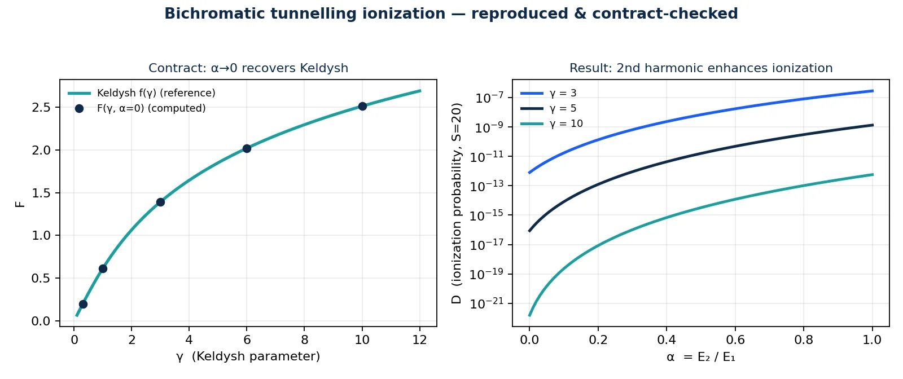

# Physics Reproducible by Agentic Construction

*By [Alexander Chernov](https://www.linkedin.com/in/thedoytsujin/). First published on LinkedIn, 2026-05-31. [Read the original](https://www.linkedin.com/pulse/physics-reproducible-construction-agentic-research-workflow-chernov-vdqee/).*

---

*I once contributed to a paper — a piece of classic strong-field physics — on how an electron escapes an atom under a two-colour laser field. The physics still holds. What I want to revisit is not the result but the **process** — because the way I would build that same research today, as a governed and reproducible workflow, is completely different from the pen-and-paper way it was actually done. So this is an old result used as a worked example of an agentic research workflow: first what it says, then how I would build it now.*

Years ago, with two colleagues, I helped derive an analytical expression for the ionization of an atom in a bichromatic laser field — a fundamental frequency together with its second harmonic. The result generalized the well-known Keldysh formula to the two-colour case, and it showed something pleasing: adding the second harmonic, with the right phase and intensity, can sharply enhance ionization. Coherent control, on paper.

I am not here to re-litigate the physics. I am here because the *process* is the interesting part now. So let me do two things — explain what the result actually says, and then rebuild it the way I now build research infrastructure: as an agentic, reproducible workflow rather than a derivation you have to re-read in order to trust.

## What the result is about

Start with a bound electron sitting in the potential well of an atom. Shine an intense laser on it and something counter-intuitive becomes possible: the electron can *tunnel* out. The oscillating electric field, added to the atom's own potential, bends the wall that holds the electron in — far enough, for long enough, that there is a finite probability of escape. And because the field oscillates in time, that wall is not static. It breathes, rising and falling each optical cycle.

Whether "tunnelling" is even the right picture is governed by a single dimensionless number: the **Keldysh adiabaticity parameter** `γ`. When `γ` is small, the field changes slowly compared with the time the electron needs to cross the barrier, and the process really does look like tunnelling through a quasi-static wall. When `γ` is large, the wall flickers too fast for that picture, and ionization is better described as the simultaneous absorption of many photons. The strength of the Keldysh framework is that one expression bridges both regimes.

Now make the field **two-colour**: a strong fundamental at frequency `ω` plus its second harmonic at `2ω`, with a relative strength `α = E₂/E₁` and a controllable relative phase. The second harmonic breaks the symmetry of the field — it makes one half-cycle push harder than the other — and that asymmetry is a knob you can turn. Using the **imaginary-time method** (a standard technique for tunnelling problems, in which the electron's path under the barrier is followed in imaginary time), we derived the escape probability in the form

`D = exp(−(q²/ω)·F(γ, α))`,

where `F` is a "tunnelling exponent" that carries all of the physics and the under-barrier time is fixed by a transcendental equation. The smaller `F` is, the larger the ionization probability `D`.

Any result of this kind has to respect its limits, and checking them is half the work:

* with the second harmonic switched off (`α → 0`), `F` must collapse back to the original monochromatic Keldysh result — and it does;
* in the strong-field, slowly varying limit (small `γ`) it must reproduce the familiar static-field tunnelling exponent — and it does;
* and in between, the second harmonic interferes constructively and *lowers* `F`, which *raises* the ionization probability. That enhancement — coherent control of ionization by a second colour — was the point of the paper.

## Where this physics is put to work today

It would be easy to read all of this as a museum piece. It is not. The specific move at the heart of the result — *shaping a laser field out of two colours to control how an atom ionizes* — turns out to be one of the central tools of modern ultrafast and strong-field physics. A few of the places it shows up:

* **Attosecond science and high-harmonic generation.** Tunnelling ionization is the *first* step of high-harmonic generation: an electron is freed, driven back by the oscillating field, and recombines, emitting a burst of extreme-ultraviolet light. Two-colour `ω + 2ω` fields — exactly the bichromatic configuration here — are a standard way to break the field's sub-cycle symmetry, steer that recollision, and carve out the *isolated attosecond pulses* that let us film electron motion in real time. The relative phase between the two colours is the control knob.
* **Terahertz generation from two-colour plasmas.** Focus a fundamental and its second harmonic together into a gas, and the asymmetric field drives a net electron drift current as it ionizes — and that current radiates intense, broadband terahertz light. The `ω + 2ω` asymmetry that *enhances* ionization in this result is the very same asymmetry that makes two-colour air plasma one of the most widely used table-top THz sources, with uses from spectroscopy to security imaging.
* **Imaging molecules with their own electrons.** Because tunnelling ionization is so sensitive to the field and to the orbital the electron leaves from, it has become a *probe*: laser-induced electron diffraction and high-harmonic spectroscopy use the ionized-then-returning electron to read out molecular structure and watch bonds rearrange on femtosecond-to-attosecond timescales. The Keldysh framework that this result extends is still the language those measurements are interpreted in.
* **Coherent control, more broadly.** The underlying principle — that interference between two driving pathways (here `ω` and `2ω`) controls the outcome of a quantum process — is the same idea behind coherent control of photoionization, and even of chemical reactions: tune a phase, and you bias where the electron goes or which channel opens. Directional control of photoelectron emission with `ω + 2ω` fields is now a routine diagnostic.
* **Lightwave electronics.** At the frontier, the same ability to steer electrons with a tailored optical field, faster than a single cycle of light, is what "petahertz" or lightwave electronics is built on — driving and reading ultrafast currents in gases and solids with shaped fields. Two-colour control of ionization is one of the simplest members of that family.

None of this depends on the particular formula we derived; the point is that the *physics it describes* — adiabaticity, tunnelling, and two-colour coherent control of ionization — is alive and applied. A result that looked, at the time, like a clean analytical curiosity sits upstream of attosecond metrology, table-top THz sources, and molecular movies.

## How that research happened — and what was left implicit

At the time, this was pen-and-paper work. The derivation *was* the artifact. The limiting cases were our tests, but we ran them in our heads and wrote them up in prose. Reproducibility lived in the printed equations: if you wanted to check the result, you re-did the algebra. Provenance was the reference list. There was no shared code, no dataset, no environment to re-run — and that was completely normal. A good analytical paper was exactly this.

It worked. But notice what was *implicit*. The assumptions — a single active electron, a particular relative phase, a short-range approximation that ignores the Coulomb tail — together with the checks and the chain from equation to number, all lived in the prose and in our heads. Nothing carried them but the paper itself. If a number was wrong, or an assumption mattered more than we thought, nothing would *tell* you. You had to already know.

## The same result, today, as an agentic workflow

So I rebuilt the result — not to improve the physics, but to run it the way I now build research infrastructure. The organizing idea is the **agentic dataset**: instead of a result being an inert number in a table, it is data that carries its own context and can take part in its own validation.

Concretely, the reproduced result carries four things:

* a **descriptor** — what it is, the schema of its outputs, and the assumptions that were once implicit, now written down explicitly;
* a **contract** — the guarantees the result must satisfy to count as valid at all;
* **provenance** — a content hash of the data together with a fingerprint of the exact code that produced it, so any stored number can be traced back to the computation that made it;
* **triggers** — conditions that fire automatically: change the parameter grid and the contract re-runs, because stale data should never pass silently.

Those four are not independent labels; they interlock, and that is what makes the dataset *active* rather than passive. The descriptor is what makes the once-implicit assumptions **addressable** — "single active electron", "zero relative phase", "short-range potential" become named fields you can point at, not caveats buried in a paragraph. The contract is what turns the descriptor's promises into something a machine can check, and it travels *with* the data, so the guarantees are not a separate test file someone has to remember to run. Provenance is what lets a *downstream* result notice it has gone stale: a content hash that no longer matches is a signal, not just a receipt. And triggers are what close the loop, so the dataset can ask to be re-validated when its inputs move, refuse to be used outside the range its contract actually covers, and tell whatever depends on it that it now needs to relearn. The shift is small to state and large in consequence — from a number you have to remember the caveats for, to data that carries and *enforces* its own caveats. A dataset that knows its own schema, limits, and lineage can be validated, audited, and refused automatically, instead of relying on whoever happens to be running the pipeline to remember the rules.

The limiting cases we once checked in our heads become **executable contracts** — and they double as the test suite:

* `α → 0` reproduces the Keldysh function `f(γ)` to machine precision (10⁻¹⁶);
* the small-`γ` static-field limit converges to its known value;
* the second harmonic lowers `F`, so the ionization probability `D` rises — in the demo, by a factor of about 10⁷ as `α` goes from 0 to 1;
* and every stored number is re-derivable from the pinned code, exactly.

The computation itself runs as a staged **pipe** — `ground → compute → validate → record`. *Ground* fixes the inputs and assumptions; *compute* evaluates the physics; *validate* runs the contracts; *record* emits a provenance artifact alongside the output. The stages are explicit and ordered for the same reason a build pipeline is: each one has a defined job, and the result is "published" only once it has passed validation. None of that is specific to physics — it is the same descriptor / contract / provenance / pipe pattern I use for sprawling enterprise data, here applied to a classic, decades-old equation.

The payoff is concrete. The figure below is produced *by* the workflow — it is not pasted in. Re-run the pipe and the figure, the numbers, and the provenance artifact regenerate together, each stamped with the code fingerprint that made them.

The demo itself is small — the physics, an agentic-dataset wrapper, the contracts, and the pipe, with the contracts doubling as CI tests. The interesting part isn't the lines of code. It's that the result now travels with the evidence that it is correct.

### Could an LLM agent help here?

Worth being precise: there is no language model anywhere in this demo. The "agent" that drives the pipe is a small deterministic controller — it evaluates policies and records what happened, and nothing about it is intelligent. But it is fair to ask where an LLM-based agent *would* genuinely earn its place in a workflow like this, because the honest answer is "in a few specific spots, and always behind the contracts."

The natural ones are all drafting and triage — the bookkeeping, not the judgment:

* **Writing the descriptor from the prose.** The assumptions that were implicit in the original paper are exactly the sort of thing a language model is good at surfacing: read the derivation, propose the schema and the list of assumptions, and hand a physicist a *draft* descriptor to correct rather than a blank form to fill in.
* **Proposing the contracts.** The limiting cases are stated, in words, in the paper — "it must reduce to Keldysh as `α → 0`." An LLM can turn those sentences into *candidate* executable checks, which a human approves before they ever become gates.
* **Explaining a failure.** When a contract trips, an agent that can read the telemetry and the provenance can draft a diagnosis — "the small-`γ` check drifted after the grid changed; suspect the under-barrier solver tolerance" — and shorten the loop from *red* to *understood*.
* **A natural-language way in.** "What assumptions does this result rest on? Is it still valid at `γ = 2`?" is answerable straight from the descriptor and the contracts; an LLM is a reasonable interface to that — *as long as it answers from the governed artifacts, not from its own memory.*

The thread through all of those is a single rule: the LLM **proposes; the control plane disposes.** Its descriptor draft is still validated, its suggested contract still has to be approved and then actually pass, its failure diagnosis is a hypothesis the checks confirm or refute. And that is the quietly useful part — the agentic-dataset machinery is exactly what you need to keep a probabilistic assistant honest. A language model is fluent and confident and sometimes wrong; contracts, provenance, and triggers are precisely the apparatus that lets you accept its *speed* without trusting its *say-so*. You let it draft, and you let the executable checks decide. That division of labour — LLM for the language, contracts for the truth — is the same one the next section draws for automation in general.

## Where agents help — and where they don't

I want to be careful here, because this is where the hype usually goes wrong. Automation and AI agents are very good at the bookkeeping: carrying the derivation, running the checks, hashing the provenance, regenerating the figure when an input changes. They are *not* the ones who decide that a single-active-electron model is the right idealization, or that the constructive-interference regime is the physically interesting one, or that the result is worth believing. That judgment is still the physicist's.

This is the same point I keep coming back to: the tool does not remove the need to understand the problem. It removes the excuse for the problem to be irreproducible.

## The systems takeaway

A classic result, reproducible only by re-reading the algebra. The same result today — described, contract-checked, provenance-stamped, and re-runnable by anyone. The physics did not change. What changed is that the *process* became an infrastructure question, exactly the shift from data, to AI, to governed scientific workflows that I keep writing about.

That is what I mean by agentic research workflows: datasets that carry their own contracts and provenance, pipelines that validate themselves, and results that arrive with their evidence attached. The derivation was finished long ago. The reproducibility is what I would build today.

#AgenticAI #ResearchInfrastructure #ReproducibleResearch #ComputationalPhysics #DataEngineering #ScientificComputing #Provenance #QuantumControl

---

<small>© 2026 Alexander Chernov. All rights reserved. First published on [LinkedIn](https://www.linkedin.com/pulse/physics-reproducible-construction-agentic-research-workflow-chernov-vdqee/), which remains the canonical version; this page is a reprint by the author.</small>
