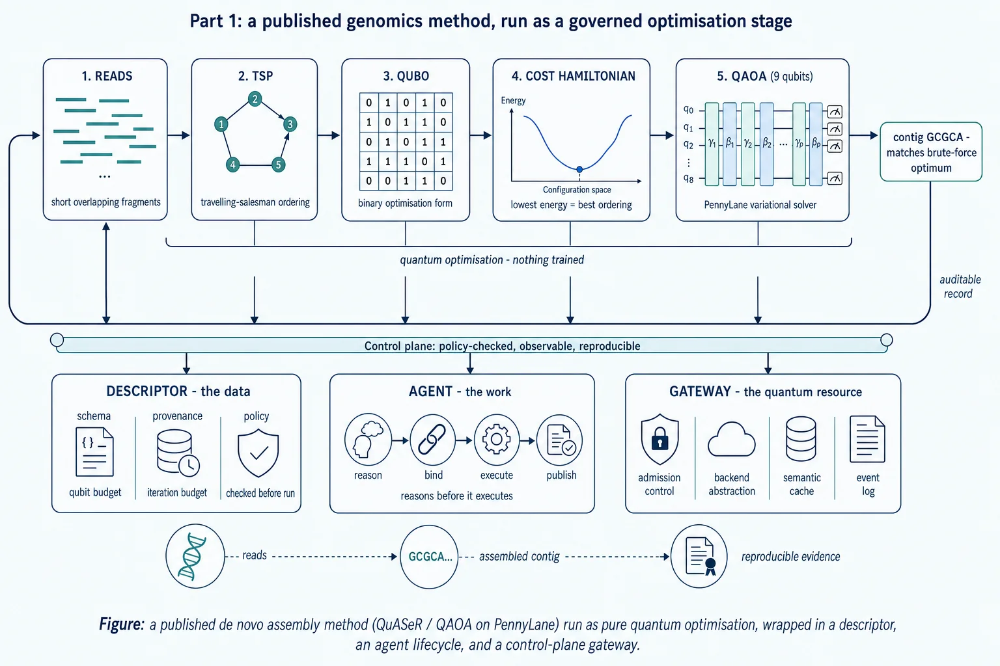

# Governing a Quantum Pipeline, Part 1

*By [Alexander Chernov](https://www.linkedin.com/in/thedoytsujin/). First published on LinkedIn, 2026-06-03. [Read the original](https://www.linkedin.com/pulse/governing-quantum-pipeline-part-1-alexander-chernov-8s1ae/).*

---

*This is the first of two parts. Here I take a real quantum-genomics method, run it on an open quantum stack, and wrap it in the governance a production workflow would actually need — as pure quantum **optimisation**, with nothing trained. Part 2 adds the AI: the same stack that lets you **solve** a circuit also lets you **train** one, and I bolt a trained quantum model onto this same pipeline, governed the same way.*

In an earlier piece I argued that quantum computing is becoming as much a software and platform discipline as a hardware one, and that data, AI, and quantum increasingly build on one another rather than standing alone. I named several frameworks only in passing — among them **PennyLane**, the open-source stack from Xanadu. PennyLane is the one that deserves a closer look, and the cleanest way to look at it is not to admire the SDK but to run something real through it and ask what it takes to operate that responsibly.

So that is what these two articles do. This is an observation about a stack and a way of working, not an endorsement of a product.

## PennyLane: one front-end, many backends

What makes PennyLane interesting as infrastructure is that its programming surface sits on top of a real engineering stack, not a single notebook.

* **PennyLane** is the programming surface — circuits expressed as ordinary Python functions (**QNodes**), reusable circuit *templates*, and quantum-chemistry tooling for building molecular Hamiltonians.
* **Catalyst** is a just-in-time compiler for hybrid quantum-classical programs, built on the MLIR compiler infrastructure. The presence of a real compiler layer is itself the tell: quantum programming has become, in part, a compiler-engineering problem.
* **Lightning** is a family of high-performance state-vector and tensor-network simulators written in C++, with GPU execution — the unglamorous, essential plumbing that makes iteration fast.
* **Plugins** connect the same front-end to many hardware backends — IBM through Qiskit, IonQ, Alpine Quantum Technologies' ion traps, Amazon Braket, and photonic devices. You write once and retarget.

That last point is the pattern I keep returning to: one front-end, many backends, behind a single uniform interface. It is the same abstraction discipline that makes any heterogeneous platform governable — here applied to quantum hardware that is otherwise wildly different underneath. (There is a second thing this stack lets you do — *differentiate* and *train* a circuit, not just run it. That is the AI side, and I am deliberately holding it back for Part 2. Part 1 is about the *solve* side and how to govern it.)

## A published quantum-genomics method

To make this concrete, I took an actual pipeline from the literature and ran it on the PennyLane stack. **QuASeR** (Sarkar, Al-Ars and Bertels, *PLoS ONE*, 2021) performs *de novo* assembly — reconstructing a DNA sequence from many short, overlapping fragments (*reads*) without a reference genome to align them to. It is one of the first steps in a sequencing pipeline, and a hard one. QuASeR's move is to treat assembly as an optimisation problem and hand that problem to a quantum computer.

One thing to flag up front: this stage is quantum *optimisation*, not machine learning — nothing here is trained. The chain is short, but each link is a genuine translation:

* the reads and their pairwise overlaps become a **travelling-salesman problem** (TSP): find the order that strings the fragments together with the most overlap, i.e. the shortest sequence that contains them all;
* the TSP becomes a **QUBO** — a *quadratic unconstrained binary optimisation*, the 0/1-variable form that quantum optimisers accept (here a variable for "read *i* sits in slot *p*");
* the QUBO becomes a **cost Hamiltonian** — an energy function whose lowest-energy state encodes the best ordering;
* and that Hamiltonian is minimised by **QAOA**, the *Quantum Approximate Optimisation Algorithm*, a variational circuit that alternates the cost and a mixing operation and is tuned to concentrate probability on low-energy (good) solutions. PennyLane implements QAOA directly.

I built that chain in PennyLane — `qml.qaoa`, a `qml.device`, a `@qml.qnode` — on a deliberately small instance: three short reads that tile the sequence `GCGCA`.

It works, within the limits of the experiment. On this small instance the QAOA circuit — nine qubits — returns a distribution whose most probable *feasible* ordering (a valid permutation of the reads) is the optimal assembly, reconstructing `GCGCA` and matching the brute-force optimum. This is a demonstration on a tiny instance, verified rather than asserted: QuASeR is explicit that QAOA's accuracy is limited at depth, and nothing here claims a quantum speedup. The point is narrower and, I think, more useful — a real bioinformatics task runs, end to end, on the open quantum stack.

## Running the method is only half the story

The other half is everything around it — and that is where data, agents, and orchestration come in. (I use *agent* here in the orchestration sense — a controller that runs a stage, evaluates its policies, and records what happened — not in the machine-learning sense; there is no model or LLM in this loop.) I wrapped the assembly stage in two layers that together behave like a small *control plane* for a hybrid quantum-classical job.

### The data, described

A **dataset descriptor** is a compact record that travels with the data and states what it is and how it may be used: its *schema* (the shape of the data), its *provenance* (where it came from and by what process), and the *policies* that constrain it. For this stage the descriptor carries resource policies — a qubit budget and an iteration budget — that are checked before the job runs. The shift is small to state and large in consequence: the data stops being an inert input and starts carrying its own rules. A dataset that knows its own schema, lineage, and limits can be validated, audited, and refused *automatically*, instead of relying on whoever happens to be running the pipeline to remember the constraints. That is what I mean by an **agentic dataset** — data that participates in its own governance rather than waiting to be acted upon.

### The agent, and why a lifecycle

An **agent** runs the stage, but not as one opaque function call. It moves through an explicit lifecycle — *reason → bind → execute → publish* — and the order is the point. In the reasoning phase it looks up the descriptor and evaluates the policies *before* anything irreversible happens; only if they pass does it bind its inputs and execute; afterwards it publishes the result together with its provenance. This reasoning-before-execution barrier is what makes autonomy safe to grant: a step that can act on its own first needs a defined moment at which it decides whether it *should*, and a record of that decision. Every transition is emitted as structured telemetry, so the run is observable in detail after the fact — not merely flagged as succeeded or failed.

### The orchestration, and the control plane

The second layer governs the quantum resource itself. In front of the backend sits a **gateway** — a *control plane* in the sense the term carries in distributed systems: it does not do the science, it decides what is allowed to run, where, and at what cost, and it keeps the system's invariants. Concretely it does four things. It performs **admission control**: a job is admitted only when the requesting tenant's policy allows the chosen backend, so an unapproved device is refused before a circuit ever reaches it. It provides a **backend abstraction**: the same job description can target a local simulator or a real machine, which is exactly what lets a workflow move from simulation to hardware without rewriting the science. It keeps cost **bounded**: rate limits, plus a **semantic cache** keyed on the circuit itself, so an identical circuit is served from cache instead of re-running — fewer redundant, billable shots on real hardware. And it records every decision as a structured event, so the orchestration is auditable as a whole, not just per job.

Those are the questions a control plane for quantum has to answer that a bare SDK does not: which workloads are admitted, how cost stays bounded across providers, and how the whole orchestration remains correct and auditable. The gateway here is a deliberately minimal version — admission, backend abstraction, caching, and event logging, not reconciliation or multi-provider scheduling — but it is the same shape, and it is enough to show why the shape matters.

The behaviour is what you would want from such a system. An approved request on an allowed backend is admitted, the QAOA assembly runs, and a contract confirms the reconstruction matches the optimum. Submit the identical circuit again and the gateway serves it from cache — no second execution. Point a request at a backend the tenant is not cleared to use and the gateway denies admission before the job reaches the device; the stage faults and the denial is in the record. Nothing reaches the quantum resource that the policy did not allow.

## Where Part 1 lands

That is the whole idea in miniature, with a real method underneath it: a published quantum-genomics algorithm, implemented on PennyLane, running as a policy-checked, observable, reproducible stage — the descriptor governing the data, the agent governing the work, and the control plane governing the quantum resource. No AI yet, and that is deliberate. The pipeline earns its governance on the *optimisation* side first.

But QAOA is only one of the two things this stack lets you do to a circuit. The same gradient machinery that *solves* a circuit here can *train* one — and a trained quantum model is genuinely machine learning, not optimisation. **In Part 2 I add exactly that:** a trained variational quantum classifier as a second stage, downstream of this assembly, governed by the very same descriptor runtime, agent lifecycle, and control plane. That is where AI meets the pipeline.

A self-contained, runnable companion accompanies the series: the QuASeR chain on real PennyLane, plus the descriptor runtime and the gateway. To reproduce the Part 1 pipeline — assembly and governance, no AI — run the demo in its stage-one mode (`python3 governed_stage.py --stage1-only`).

References:
PennyLane (GitHub): <https://github.com/PennyLaneAI/pennylane>
PennyLane: <https://pennylane.ai/>
QuASeR — Sarkar, Al-Ars, Bertels, *PLoS ONE* 16(4):e0249850 (2021): <https://journals.plos.org/plosone/article?id=10.1371/journal.pone.0249850>

#QuantumComputing #PennyLane #QuantumOptimization #QAOA #ControlPlane #AgenticDatasets #QuantumSoftware #ResearchInfrastructure #OpenSource

---

<small>© 2026 Alexander Chernov. All rights reserved. First published on [LinkedIn](https://www.linkedin.com/pulse/governing-quantum-pipeline-part-1-alexander-chernov-8s1ae/), which remains the canonical version; this page is a reprint by the author.</small>
