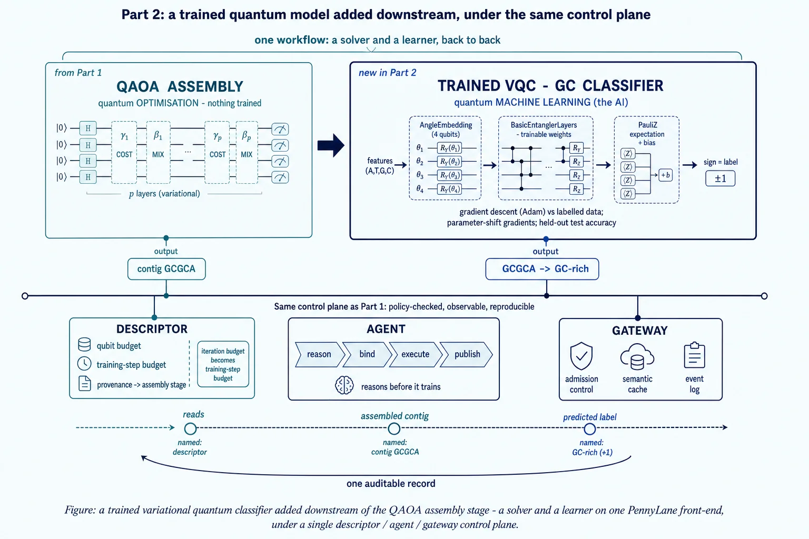

# Governing a Quantum Pipeline, Part 2

*By [Alexander Chernov](https://www.linkedin.com/in/thedoytsujin/). First published on LinkedIn, 2026-06-06. [Read the original](https://www.linkedin.com/pulse/governing-quantum-pipeline-part-2-alexander-chernov-3qfme/).*

---

*This is the second of two parts, and it builds directly on the first. In Part 1 I took a published quantum-genomics method — QuASeR's de novo assembly — ran it on PennyLane as pure quantum **optimisation**, and wrapped it in a small control plane: a dataset descriptor governing the data, an agent lifecycle governing the work, and a gateway governing the quantum resource. Nothing in that pipeline was trained. Here I add the part I deliberately held back: the **AI**. The same stack that lets you **solve** a circuit lets you **train** one, so I bolt a trained quantum model onto the very same pipeline — and govern it the very same way.*

If you have not read Part 1, the one-paragraph version is this: a real bioinformatics step (assembling a DNA sequence from short overlapping reads) was cast as a TSP → QUBO → cost-Hamiltonian → **QAOA** chain and run on nine qubits in PennyLane, reconstructing the contig `GCGCA` and matching the brute-force optimum. Around it sat a descriptor (schema, provenance, qubit/iteration budgets, checked *before* execution), a five-state agent (*reason → bind → execute → publish*), and a control-plane gateway (admission control, backend abstraction, a semantic circuit cache, and a structured event log). That is the pipeline this article extends.

## Differentiable quantum programming: the AI side of the stack

The central idea in PennyLane is simple to state and consequential in practice: a quantum circuit can be *differentiated*.

You describe a circuit as a **QNode**, and you can then take gradients through it with the same automatic-differentiation engines that train neural networks — PyTorch, TensorFlow, JAX, or NumPy/autograd. A parameterised quantum circuit becomes, mathematically, just another differentiable block you can drop into a larger model and optimise end to end. That is what people mean when they say PennyLane lets you "train quantum circuits like neural networks."

The mechanism underneath is worth a sentence, because it is what makes the claim more than an analogy. You cannot backpropagate through quantum hardware the way you can through a tensor in memory — a real device only gives you measurements. PennyLane gets the gradient anyway through the **parameter-shift rule**: to find how the output changes with a given gate parameter, it runs the same circuit twice with that parameter nudged by a fixed amount and takes the difference. The result is an *exact* analytic gradient that can be obtained on real hardware, not a finite-difference approximation — which is precisely why the same training loop works whether the QNode runs on a simulator or a quantum device. The autodiff engine stitches those per-gate gradients together, and gradient descent does the rest.

This is the complement to Part 1. QAOA *solves* a fixed problem: it tunes a circuit's parameters to minimise one cost Hamiltonian, and when it is done you read off an answer. A **trained model** is different in kind — it *learns* from data, so that it generalises to inputs it has never seen. Both are variational circuits optimised by gradient descent; only one of them is machine learning. Part 1 exercised the first. Part 2 adds the second, on the same hardware-agnostic stack and behind the same governance.

## Adding a trained stage to the pipeline

The natural place for AI in this pipeline is *downstream of assembly*. Part 1 reconstructs a contig; it does not interpret it. So I added a second stage that does: a **variational quantum classifier** (VQC) that labels the reconstructed sequence by nucleotide composition — **GC-rich vs AT-rich**, a real and simple genomic property.

The classifier is genuinely trained, and the construction is worth seeing in detail because every piece has a neural-network counterpart. Each sequence is reduced to a four-number feature vector — the frequencies of A, T, G, and C — scaled into angles and **angle-encoded** onto a four-qubit circuit (PennyLane's `AngleEmbedding`). On top of that sit three layers of an entangling template (`BasicEntanglerLayers`), which is where the *trainable* weights live — the quantum analogue of a small stack of dense layers. The circuit's output is the expectation of a single Pauli-Z measurement on one qubit, a number in [−1, 1], to which a trainable bias is added; the sign of the result is the predicted class. Training minimises a plain mean-squared-error loss between that output and ±1 targets, using the Adam optimiser — the identical recipe you would reach for with a classical model, except the forward pass runs a quantum circuit and the gradients come from the parameter-shift rule above.

What it trains *on* matters as much as how. The model learns from a balanced, labelled set of short DNA sequences — equal numbers of GC-rich and AT-rich examples, with the ambiguous borderline around a 50% GC fraction deliberately excluded so the label is never in doubt — split into a training portion and a held-out test portion it never sees during optimisation. Reporting accuracy on that held-out split, rather than on the data it trained on, is the difference between a model that *learned* and one that merely memorised. Applied to the contig `GCGCA` that Part 1 assembled, the trained circuit returns *GC-rich*, correctly and with a comfortable margin.

It is a small, honest task. The point is not that a quantum classifier beats a one-line `if` statement on GC content — it obviously does not. The point is that a *trained quantum model* is now a first-class stage in the pipeline, sitting immediately downstream of a quantum *optimiser*, both written against the same PennyLane front-end. The data-to-AI-to-quantum arc stops being a slogan here: it is one workflow in which the same gradient machinery runs a solver and a learner back to back.

## Governed exactly like the optimisation stage

The part I care most about is that adding AI did *not* mean adding a second, ungoverned escape hatch. The trained stage runs under the same control plane Part 1 built, with the differences you would expect made explicit rather than hidden:

* **Its own descriptor.** The classification stage carries its own dataset descriptor — output schema (`GC-rich` / `AT-rich`), provenance that names the trained-VQC method and links back to the assembly stage as its source, and resource policies. Where the assembly descriptor bounded a qubit budget and an iteration budget, this one bounds a qubit budget and a **training-step budget** — a learned model's distinctive cost is the training, so that is what the policy governs, checked before the stage runs.
* **The same agent lifecycle.** The classifier stage is driven by the same *reason → bind → execute → publish* agent. It evaluates its training and qubit budgets in the reasoning phase, *before* it trains anything, and it publishes the label with full provenance. The reasoning-before-execution barrier that made the optimisation stage safe to automate makes the AI stage safe to automate for the same reason.
* **The same gateway.** The classifier's circuit is admitted through the same control-plane gateway as the QAOA circuit — the same admission control against the tenant's allowed backends, the same rate limits, the same semantic cache (classify the identical contig twice and the second is served from cache), and the same structured event record. The AI does not get a private door to the quantum resource.
* **The same contract discipline.** As with assembly's "reconstruction matches the optimum," the AI stage publishes against a contract — the predicted label is checked against ground truth, and the trained model has to clear a held-out-accuracy floor before its output is accepted. A model that trained badly fails its contract rather than silently shipping a guess.

There is a quieter payoff in that first bullet. Because the classification descriptor names the assembly stage as its source, the two stages are not just adjacent — they are *linked*, and the link is recorded. The provenance now reads as a chain: raw reads → the QAOA-assembled contig → the trained-VQC label, each step naming the one before it and the method that produced it. That is what lets you answer, after the fact, not only "what did the AI predict" but "what was it predicting *about*, and where did that come from" — the question that governance exists to keep answerable when a learned model sits in the middle of a pipeline.

Run the full two-stage pipeline and the behaviour is exactly the union of the two stories: the assembly is admitted and executes, the trained classifier labels the contig and passes its contract, an identical resubmission is served from the cache, and a request for an unapproved backend is denied before it reaches the device. Two stages — one that solves a circuit, one that trains one — under a single, auditable control plane.

## The observation

Strip away the branding and PennyLane is a useful lens on where quantum computing is heading: hardware-agnostic, compiler-backed, autodifferentiation-native, and openly reproducible. It treats a quantum program as differentiable software that lives inside the ordinary machine-learning toolchain — and it exposes many different machines through one interface.

That is what "quantum is becoming a software discipline" looks like when you write it in actual code. And taken across both parts, it is where the data-to-AI-to-quantum progression stops being a slogan. Part 1 showed that a quantum *optimisation* stage can be run like a governed production workflow. Part 2 showed that a *trained* quantum model slots into that same workflow under the same governance — that AI and quantum are not separate stories bolted together, but two stages of one optimisation loop, governed alike. The interesting frontier is not only making quantum circuits trainable; it is making the whole hybrid pipeline — optimiser and learner together — something you can operate, audit, and trust.

A self-contained, runnable companion accompanies the series: the QuASeR QAOA chain, the trained VQC classifier, and the shared descriptor runtime and gateway. The default run exercises both stages of this Part 2 pipeline (`python3 governed_stage.py`); the Part 1 pipeline alone is `python3 governed_stage.py --stage1-only`.

References:
PennyLane (GitHub): <https://github.com/PennyLaneAI/pennylane>
PennyLane: <https://pennylane.ai/>
QuASeR — Sarkar, Al-Ars, Bertels, *PLoS ONE* 16(4):e0249850 (2021): <https://journals.plos.org/plosone/article?id=10.1371/journal.pone.0249850>

#QuantumComputing #PennyLane #QuantumMachineLearning #DifferentiableProgramming #QuantumSoftware #ControlPlane #AgenticDatasets #OpenSource

---

<small>© 2026 Alexander Chernov. All rights reserved. First published on [LinkedIn](https://www.linkedin.com/pulse/governing-quantum-pipeline-part-2-alexander-chernov-3qfme/), which remains the canonical version; this page is a reprint by the author.</small>
