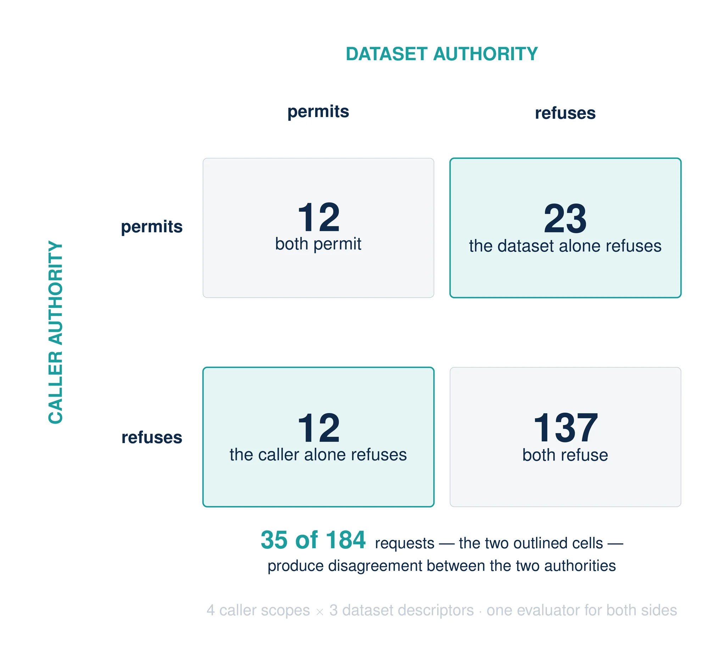
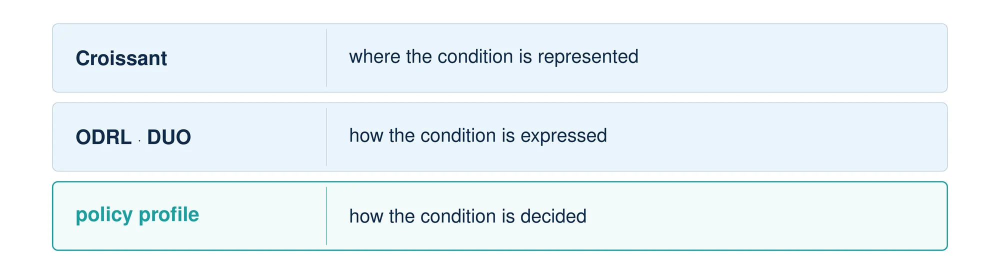
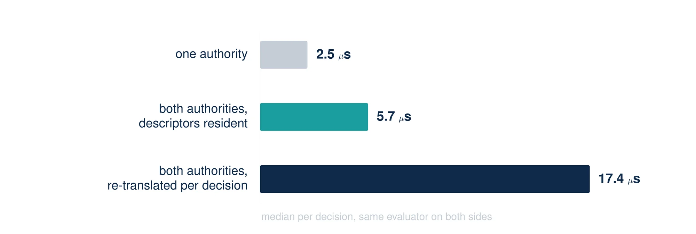

# Harmless AI Is Not a Property of the Model

*By [Alexander Chernov](https://www.linkedin.com/in/thedoytsujin/). First published on LinkedIn, 2026-09-13. [Read the original](https://www.linkedin.com/pulse/harmless-ai-property-model-alexander-chernov-b2aac/).*

---

Write down the policy an agent carries, write down the policy its data carries, and compare them. Each refuses requests the other admits, and each refuses on facts the other does not have. A harmless model therefore does not give you a harmless system, because the authority to refuse is not in one place and cannot be moved into the model.

Most of the discussion about harmless AI is about training: how to align a model, how to stop a jailbreak, how to keep an unsafe instruction from producing an unsafe output. Once a system is agentic that stops being the whole problem. The agent retrieves data, assembles context, calls tools, crosses system boundaries, and changes things. Safety has to live at those boundaries as well.

## The idea came from a robot

*Figure 1 — The robot and the dataset refuse in the same place. The autonomous component proposes, a boundary it does not control decides, and the refusal lands before the consequential action rather than after it.*

This argument started in robotics. At IEEE CBS 2026 I presented a supervisory architecture for biomedical manipulators in which an unsafe intent is refused before the planner or the driver is ever invoked. The controller proposes a motion. A supervisory boundary holds the lifecycle state and the policy and decides whether the motion happens. The controller is autonomous, and it is not the final authority on its own actions.

Dataset access has the same shape. An agent proposes a retrieval, a query, a transformation, or an export. It knows what it wants to do. It does not necessarily hold the facts that decide whether the action is admissible.

So the two systems refuse in the same place. The robot refuses before actuation. The dataset refuses before retrieval. What is being protected differs, a physical process in one case and an information boundary in the other, and the mechanism differs with it. The position of the decision does not.

## Two authorities, and neither contains the other

*Figure 2 — Caller-side and dataset-side authority are not interchangeable. The outlined cells are the 35 requests on which the two authorities disagree.*

The comparison is measurable, so I measured it. A published experiment evaluates 184 requests — four caller scopes against three real dataset descriptors — through a single evaluator, so that any disagreement comes from the policies rather than from two different engines. Both sides permitted 12 requests and both refused 137. The dataset alone refused 23. The caller alone refused 12.

That reads as a deployment choice. An agent control plane on its own admits 23 requests that some authority had refused. An admission gate on the data alone admits 12. Consulting both, and letting either one refuse, admits none of them.

Those counts are softer than they look, and the softness is worth stating plainly. The caller scopes are a model of what agent platforms describe rather than a measurement of a real one, so 23 and 12 are designed numbers. The request matrix is also weighted toward violations on purpose, so the disagreement rate belongs to the matrix and not to production traffic.

What survives the caveat is the part that never depended on the scopes. Three of the dataset's refusals turn on its own lifecycle state, which the caller does not know. Six of the caller's refusals turn on assurance that has lapsed, and four on an entitlement it does not hold, and the dataset knows neither. Both sides are written in the same descriptor format and decided by the same evaluator, so the gap is not in the policy language. It is in where the state lives. One policy naming both kinds of fact would still have to ask the dataset for its lifecycle and the caller's platform for its assurance, which is consulting both authorities under another name.

## The dataset is one of the authorities

*Figure 3 — What a dataset carries is what lets it answer. Presented with an identity, a purpose and an operation, a surface that holds its own policy and lifecycle state permits or refuses; the agent never meets the files.*

This is what changes when a dataset stops being a passive input. A conventional dataset holds files, tables, and metadata, and the application decides what may be done with them. A dataset can instead carry its own descriptor, its policy, its provenance, and the conditions under which it must be revalidated, and then answer a request rather than merely serve it. The agent presents identity, purpose, and the operation it wants, and the dataset permits or refuses it.

Refusing before retrieval is the whole point. The safest sensitive information in a context window is the information that never entered it. A model asked to hold data it must not reveal is being asked to solve a problem that could have been prevented one step earlier.

## Why Croissant matters

None of this has to become a proprietary policy system, because datasets are already growing a machine-readable control surface.

Croissant began as a standardized metadata vocabulary for datasets: what the files are, what the columns mean, how to load them. Croissant 1.1, published in January 2026, reaches well past description. It carries provenance in W3C PROV-O terms, so a dataset can say what it was derived from, by which processing step, and which person or piece of software is answerable for it. It names `sc:usageInfo` as the place a dataset's conditions of use belong, with DUO codes for simple restrictions and W3C ODRL policies for fine-grained ones. MLCommons published the release as an agent-ready standard, and says in terms that the restrictions are machine-readable so that automated systems can check them.

That matters because an agent cannot respect a condition it cannot discover. Croissant gives a dataset a standard place to describe itself: what it is, where it came from, how it may be used, and what restrictions travel with it. Governance stops being prose in a dataset card and becomes data.

Description and enforcement remain different things. Croissant says where a usage condition belongs. It does not define a procedure for deciding one, bound what a condition may cost to check, say what an evaluator should do with a condition it cannot understand, require a record of what was checked, or describe how a data-side condition composes with the authority governing the caller.

*Figure 4 — Three layers of one question. The first two are settled by standards; the third is what this work supplies.*

Those five omissions are not a complaint about Croissant. A metadata standard's job is to fix where a fact belongs and what it means, and stopping there is what lets everyone implement it the same way. Drawing the line there is also what leaves a well-posed question on the other side of it, with representation already settled and out of the way: given a condition written down in a standard place, what procedure decides it, and what does that procedure cost. Five clean gaps are a better place to start research than one vague one.

## Metadata is not enforcement

*Figure 5 — Croissant is the carrier, not the gate. Each authority supplies the facts it owns, the gate composes them and fails closed, and the receipt records what was checked.*

Croissant is not the authorization engine in this experiment. It is the carrier.

The policy profile supplies the executable half: a closed set of five decidable conditions, fail-closed treatment of anything the evaluator cannot process, and a decision record naming what was checked. The same policy ships in two carriers that decide identically, either as compact terms on the dataset node or as an ODRL policy in the `sc:usageInfo` slot Croissant defines for it. Four of the five operators turn out to be ODRL core operators, which is the shortest available statement that the disagreement was never about expressiveness. Where richer rights modeling is needed, ODRL is the right tool and this does not compete with it.

The proposal is therefore not to replace Croissant, ODRL, or the agent platform. It is to connect them at an enforcement boundary. Croissant describes the dataset. The caller describes its authority. The gate composes the two. Each component keeps the facts the others should not have to invent.

## Consulting both is cheap

*Figure 6 — The median cost of one decision. Consulting both authorities doubles a very small number, and re-translating both descriptors on every decision triples that again.*

The obvious objection is cost. In this implementation, with both descriptors already loaded, the median joint decision took 5.7 microseconds against 2.5 for a single side, the factor of two anyone would predict. Translating both descriptors again on every decision, as a per-task hook does, raises it to 17.4 microseconds. Consulting two authorities instead of one is not expensive. It has simply not been specified.

## The model proposes and the boundary decides

We already build every other kind of system this way. A robot controller does not redefine its own safety interlocks. A process does not decide which operating-system permissions apply to it. A database client does not grant itself authorization because its request looks reasonable. In each case the authority sits outside the component, because a component that has been compromised cannot be trusted to police itself.

Agentic AI should inherit that discipline. The model proposes. The tool, the dataset, or the physical system contributes the state and the policy it owns. A boundary evaluates the composition and leaves evidence of the decision.

That is a stronger definition of harmlessness than asking a model to behave well. It does not assume that any one component sees the whole system, and it does not require every authority to collapse into a single policy.

Harmlessness is a property of the interaction between autonomous components and boundaries they do not control.

Sources. Croissant Format Specification 1.1, 29 January 2026: https://docs.mlcommons.org/croissant/docs/croissant-spec-1.1.html · the release announcement: https://mlcommons.org/2026/02/croissant-1-1-standard/ · ODRL Information Model 2.2, which defines an ODRL Evaluator and leaves how it decides to the implementer: https://www.w3.org/TR/odrl-model/ · the profile, both carriers, the experiment behind Figure 2 and the joint decision receipt: https://github.com/doytsujin/ok-croissant-policy-profile, archived at https://doi.org/10.5281/zenodo.22018156 · Figure 1 follows "Policy-Aware Supervisory Control for Observable Embodied Biomedical Robotic Systems", IEEE CBS 2026, Munich.

#AgenticAI #AISafety #DataGovernance #AIInfrastructure #ControlPlane #Croissant #MLCommons

---

<small>© 2026 Alexander Chernov. All rights reserved. First published on [LinkedIn](https://www.linkedin.com/pulse/harmless-ai-property-model-alexander-chernov-b2aac/), which remains the canonical version; this page is a reprint by the author.</small>
