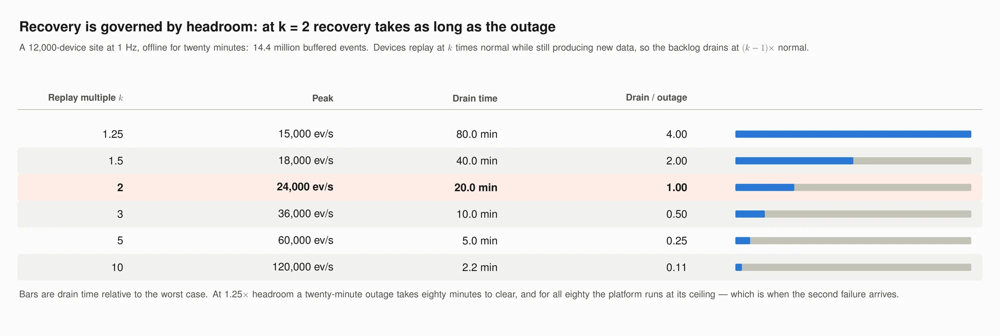
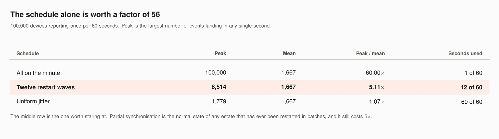

# At 100,000 Devices, Nothing Fails at the Average

*By [Alexander Chernov](https://www.linkedin.com/in/thedoytsujin/). First published on LinkedIn, 2026-09-01. [Read the original](https://www.linkedin.com/pulse/100000-devices-nothing-fails-average-alexander-chernov-cdcec/).*

---

*Part 2 of two: what happens when things move.*

**Part 1** measured where load lands in a 100,000-device estate, and the result was blunt. Hash 100,000 equipment ids through Kafka's murmur2 keyed-partitioning calculation, weight each key by its device's rate, give one instrument a fault, and going from 16 partitions to 1024 improves the cluster average by exactly 64× while improving the actual bottleneck by 1.25×. The 64 is just 1024/16 — the mean is total load over partition count, so it reports the change you made to the denominator and nothing about the cluster.

That was a system standing still. This part is about the system moving: a site that reconnects with twenty minutes of backlog, a fleet that all reports on the same second, a pipeline that ships a schema change, and a certificate that expires on a Sunday. Every one of them is a failure that an average cannot see, for the same reason the average could not see the hot partition.

Two of the three measurements are here; the harness and the browser calculator are the same ones, at [doytsujin.github.io/ok-kafka-estate-calc](https://doytsujin.github.io/ok-kafka-estate-calc/). As in Part 1, everything that is not measured is arithmetic from stated assumptions and is marked as such.

## Recovery, not average traffic, is the design point

A manufacturing site with 12,000 devices loses its upstream network for twenty minutes. The devices keep operating and buffer locally. Then connectivity returns and every device starts replaying at once. At 1 Hz that is 14.4 million buffered events arriving at a platform that was sized for 12,000 a second, and the pressure propagates through every layer in turn.

This one has a closed form, and it is worth knowing. If each device replays at `k` times its normal rate while still producing new data, the backlog drains at `(k-1) × normal` and clears in `outage / (k - 1)`. Simulation and closed form agree to the timestep.

**At `k = 2`, recovery time equals outage time.** Twice normal capacity buys a recovery exactly as long as the outage that caused it. Comfortable-sounding headroom is not comfortable: at 1.25× a twenty-minute outage takes eighty minutes to clear, and for all eighty of them the platform is running at its ceiling — which is exactly when the second failure arrives.

So the capacity question is not what the average ingestion rate is. A system that comfortably handles average traffic can fail precisely when it is trying to recover from the previous failure, and that is how cascading failures begin.

## The schedule is worth a factor of 56

Now suppose 100,000 devices are configured to report once per minute. The average rate is about 1,667 events/sec. Nothing frightening — unless every device reports at `12:00:00`, `12:01:00`, `12:02:00`.

I ran all 100,000 devices through three reporting schedules and measured the peak events landing in any one-second window.

Same devices, same volume of data, same retention. The schedule alone is worth a factor of 56 in peak load, and the middle row is the one worth staring at: devices that came back in a handful of restart waves — a site power event, a fleet firmware push — still cost 5×, because partial synchronisation is the normal state of any estate that has ever been restarted in batches.

The problem is not insufficient Kafka tuning. It is a thundering herd, and the fix is jitter applied before the event ever reaches Kafka.

## The topology is code, or it is a liability

Once Kafka is production-critical, topics, schemas, ACLs, brokers, connectors, SLOs, upgrades and incident response are software-delivery concerns rather than messaging concerns. Many of the hardest failures in that infrastructure begin with an apparently routine change somebody shipped.

That puts Kafka across the whole lifecycle. Application changes introduce new producers, consumers, topics, schemas and partitioning behaviour, and CI should validate them before rollout rather than after. Clusters, topics, quotas, ACLs, connectors, service accounts, retention policies and monitoring are declarative artefacts and belong in Terraform or GitOps alongside everything else. Observability means consumer lag, request latency, ISR health, rebalances, broker saturation and end-to-end event latency, at the granularity the drill-down above demands. Replication, `acks`, `min.insync.replicas`, failure-domain placement, capacity headroom, retries, DLQs, idempotence and cross-region replication are reliability settings that live in version control. And because Kafka sits in the middle of most incident chains, runbooks have to distinguish producer, broker, consumer, schema, network and downstream failures rather than paging on "Kafka".

Upgrades deserve their own sentence, because protocol and client-version compatibility is the classic way a routine change becomes an outage. Progressive rollout, compatibility testing and a rehearsed rollback are not optional at this scale.

Nothing exotic. It is ordinary DevOps applied to a component that often escapes it because it is filed under "messaging".

## Security controls are part of the availability model

Kafka in a regulated environment carries data that has an access model, and that adds a set of questions the throughput conversation never reaches. Who can produce, who can consume, and to which topics? Can one tenant read another's data? Are credentials rotated? Is traffic encrypted in transit and at rest? Can sensitive fields leave their permitted boundary? Can an administrator alter retention or ACLs without leaving a trace?

The controls are well understood: TLS, SASL or OAuth rather than shared passwords, topic- and cluster-level ACLs, per-service identities, secrets in a real secrets manager, certificate and credential rotation, network segmentation, schema and payload validation, quotas, audit logging, retention controls, and scanning of both Connect plugin images and the dependencies of producer and consumer applications. Provisioned the same way as everything else.

Here is the part that matters for reliability, and it is the reason this section is in a throughput article at all. **Security controls cause outages, and they cause the quiet kind.**

Consumer lag looks *normal*. It looks normal because lag measures the distance between what was written and what was read, and nothing was written. The health metric is arithmetically incapable of seeing the failure, in the same way the cluster average is incapable of seeing the hot partition. A producer-side certificate expiry presents as a quiet system.

The other two chains in that figure are noisier but no less real. A rollout that removes a consumer's READ permission turns it into a retry loop that never drains, and a compromised or buggy producer publishing a hundred times its normal volume becomes broker pressure and then cluster degradation.

That third one is the hot-partition measurement again, arriving through the security door instead of the firmware door — and the quota that stops it is a security control doing reliability work. Authentication, authorisation, quotas, certificates and network policy are part of the availability model, not adjacent to it. Teams that separate the two end up with a security calendar that schedules outages.

## The difficult questions are about failure

At 100,000-device scale I am not very interested in whether Kafka can process 100,000 messages per second. It is a useful benchmark and it says surprisingly little about whether the system is reliable. I would rather ask:

- What happens when a site reconnects and replays thirty minutes of buffered telemetry?
- What happens when one consumer falls hundreds of millions of events behind?
- Can an availability-zone failure occur without losing the manufacturing event stream?
- What happens if a firmware defect causes 20,000 devices to publish a hundred times more frequently?
- Can we distinguish a duplicate measurement from a legitimate repeated measurement?
- What happens when an event arrives forty-five minutes late?
- Which certificate expires next, and what stops when it does?

And, in a regulated environment, the one that matters most: **can we reconstruct the exact state of a batch at a particular point in time?**

That question leaves throughput behind entirely. It touches ordering, event time versus processing time, replay, idempotency, schema evolution, provenance, retention, auditability and state reconstruction. Those are distributed-systems questions, they are reliability-engineering questions, and increasingly they are delivery-pipeline questions, because the answer depends on what a deployment three months ago did to a schema.

## Reliability starts where the benchmark ends

At sufficient scale, backpressure, consumer lag, partition skew, ISR degradation, retry amplification, gray failures, recovery bursts, capacity headroom, late-arriving events and failure-domain isolation stop being vocabulary. They become architectural properties of the system, and each one is a thing you either designed for or did not.

Three of them now have numbers attached across the two parts, and the numbers point the same way each time. The cluster average improves by exactly the factor you grew the denominator by, while the bottleneck does not move. Lag reads normal while nothing is being published. A schedule nobody chose costs a factor of 56. In every case the reassuring measurement and the actual failure are looking at different things, and the reassuring one is the one on the wall.

If you want the three measurements against your own estate rather than mine, the calculator is at [doytsujin.github.io/ok-kafka-estate-calc](https://doytsujin.github.io/ok-kafka-estate-calc/). It is deliberately not a broker benchmark and has no output that answers whether your cluster can cope — that question needs your cluster. What it will tell you is where the load actually lands, what your reporting schedule costs, and how much headroom your recovery needs.

The challenge is not moving a very large number of messages. It is that when devices, networks, brokers, consumers, sites, certificates and downstream systems behave in unexpected ways — and they will — the platform has to absorb the disturbance, preserve the meaning of the data, recover predictably, and tell you exactly what happened.

Throughput is where that conversation starts, not where it ends.

---

<small>© 2026 Alexander Chernov. All rights reserved. First published on [LinkedIn](https://www.linkedin.com/pulse/100000-devices-nothing-fails-average-alexander-chernov-cdcec/), which remains the canonical version; this page is a reprint by the author.</small>
