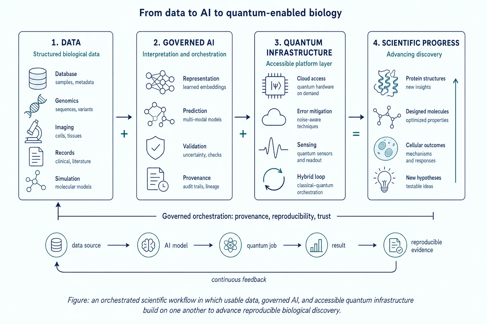

# From Data to AI to Quantum-Enabled Biology

*By [Alexander Chernov](https://www.linkedin.com/in/thedoytsujin/). First published on LinkedIn, 2026-05-30. [Read the original](https://www.linkedin.com/pulse/from-data-ai-quantum-enabled-biology-alexander-chernov-p1jre/).*

---

I've been looking at the work coming out of The University of Osaka's **Center for Quantum Information and Quantum Biology — QIQB**.

What caught my attention was less the quantum hardware itself than the broader research architecture around it. QIQB brings together several areas that are often discussed separately: quantum computing, quantum information devices, quantum communication and security, quantum measurement and sensing, and quantum biology.

That combination matters because the future of quantum research goes beyond building better devices. It is equally about building the surrounding infrastructure that makes those devices useful: cloud access, software stacks, experiment control, data workflows, security, reproducibility, and interdisciplinary collaboration.

It also points to a wider arc I want to trace here — the movement from data, to AI, to quantum-enabled biology — and why each step in that arc builds on the infrastructure beneath it rather than standing alone.

QIQB: <https://qiqb.osaka-u.ac.jp/en/>

Osaka University Quantum Computing Cloud: <https://www.qiqb-cloud.jp/>

OQTOPUS: <https://oqtopus-team.github.io/>

## Why QIQB Stands Out

Public sources point to several notable elements: QIQB's six research areas, the OQTOPUS open-source quantum cloud stack, a QIQB quantum-cloud portal, and the July 2025 launch of a domestically developed superconducting quantum computer at QIQB.

The striking part is that it shows quantum computing as more than a laboratory capability — it is becoming a platform capability.

That distinction is important.

A laboratory capability may demonstrate that a machine exists and can run experiments. A platform capability asks a bigger question:

How can researchers, students, engineers, and application developers access, use, reproduce, govern, and integrate this capability into real scientific workflows?

That is where the systems dimension begins.

## From Quantum Hardware to Quantum Infrastructure

The most visible part of quantum computing is usually the hardware: superconducting qubits, trapped ions, photonics, cryogenic systems, microwave control, optical control, error mitigation, and experimental stability.

But hardware alone is not the full story.

To make quantum systems useful across disciplines, we also need infrastructure around the hardware:

* cloud execution environments;
* open-source software stacks;
* scheduling and workload management;
* experiment control;
* compilers and transpilers;
* hybrid quantum-classical workflows;
* error mitigation;
* access control;
* provenance and auditability;
* reproducibility;
* integration with classical high-performance computing and data platforms.

This is why the OQTOPUS direction is notable. An open-source stack for cloud-based quantum computers suggests that quantum computing is becoming as much a software, operations, and platform engineering discipline as a physics and hardware challenge.

That is a major shift.

OQTOPUS also does not stand alone. It joins a growing ecosystem of frameworks for actually writing and running quantum programs: IBM's Qiskit, Google's Cirq, and Xanadu's PennyLane for hybrid quantum-classical and quantum machine learning, alongside managed cloud services such as Amazon Braket and Microsoft Azure Quantum that expose several hardware backends behind a single interface. The fact that a researcher today reaches first for a software development kit, a transpiler, and a cloud endpoint — rather than a cryogenic lab — is itself a clear sign of how far quantum computing has moved toward a software and platform discipline.

Qiskit (IBM): <https://www.ibm.com/quantum/qiskit>

Amazon Braket (AWS): <https://aws.amazon.com/braket/>

## How Data, AI, and Quantum Build on One Another

One reason this topic interests me is that modern biology is increasingly becoming a data-intensive discipline.

Genomics, proteomics, imaging, electronic health records, lab automation, molecular simulation, and biomedical literature all produce massive and heterogeneous data streams. The challenge is no longer collecting data. It is making that data usable, trustworthy, reproducible, and actionable.

This is where AI has already changed the landscape.

Machine learning and foundation models are being used to search literature, classify biomedical signals, analyze images, predict molecular properties, support drug discovery, and assist with biological interpretation.

But AI systems also introduce new infrastructure requirements:

* data provenance;
* model governance;
* traceability;
* validation;
* monitoring;
* reproducibility;
* careful control over automated decisions.

Quantum computing and quantum sensing add another layer to this evolution.

In biology, quantum-related capabilities may become relevant through quantum chemistry, molecular simulation, nanoscale sensing, optimization, and hybrid quantum-classical workflows. These capabilities do not replace classical data platforms or AI systems. Instead, they may become specialized components inside larger scientific workflows.

What makes this powerful is that the layers compound. Each one builds on the one before it. Usable, well-described data is what makes AI dependable. Governed AI is what makes a quantum resource worth pointing at a real biological question. And a reproducible workflow is what turns any single result into something other researchers can build on. The progression from data to AI to quantum is therefore additive, not a hand-off: data plus AI plus quantum adds up to capability that no single layer delivers on its own.

That is why the connection from data to AI to quantum computing matters.

The future research environment may not be a single model, a single database, or a single quantum computer. It may be an orchestrated scientific platform where biological datasets, AI models, simulation tools, quantum resources, lab instruments, and human researchers interact through governed workflows.

In that kind of environment, infrastructure becomes central.

We need systems that can answer practical questions:

* What data was used?
* Which model or simulation produced this result?
* Which assumptions were applied?
* Was a quantum resource used, and under what conditions?
* Can the result be reproduced?
* Was the workflow approved, monitored, and governed?
* Can another researcher understand the full chain from biological question to computational result?

This is where I see a direct connection to intelligent control planes, dataset descriptors, provenance, and policy-governed scientific computation.

Quantum biology may be an emerging field, but the data and infrastructure questions it raises are already familiar: how to make complex scientific workflows reliable, explainable, reusable, and trustworthy.

## Why Quantum Biology Is a Careful but Important Direction

Quantum biology should be discussed carefully.

It should not be treated as a shortcut to claim that quantum computers are already transforming all biological research. That would be too sweeping.

But the research direction is important.

Biological systems involve molecular interactions, energy transfer, electronic structure, sensing, noise, and dynamics at very small scales. Some of these questions naturally touch quantum chemistry, quantum measurement, and nanoscale sensing.

It is tempting to ask:

Can quantum computers solve biology on their own?

A more realistic and productive question is:

How can quantum methods, quantum-inspired methods, quantum sensing, and high-quality computational infrastructure improve the way we study biological systems?

That question connects quantum biology with computational biology, AI, data engineering, and scientific infrastructure.

## The Canadian Context

This topic is also relevant in Canada.

The University of Waterloo's **Institute for Quantum Computing** is one of Canada's major quantum research hubs, bringing together science, mathematics, and engineering around quantum information science and technology.

Institute for Quantum Computing, University of Waterloo: <https://uwaterloo.ca/institute-for-quantum-computing/>

The University of Toronto's **Centre for Quantum Information and Quantum Control** is a second important Canadian reference point. It frames quantum research across physics, chemistry, mathematics, computer science, electrical engineering, and related disciplines.

Centre for Quantum Information and Quantum Control, University of Toronto: <https://cqiqc.physics.utoronto.ca/>

This matters because quantum research increasingly depends on interdisciplinary capacity. It spans far more than physics: computer science, electrical engineering, materials science, chemistry, mathematics, security, cloud infrastructure, and eventually domain-specific scientific applications.

Canada's expanding quantum ecosystem is well positioned for this kind of interdisciplinary work.

## IEEE Quantum Week / QCE 2026 in Toronto

A timely connection is **IEEE Quantum Week 2026**, also known as the **IEEE International Conference on Quantum Computing and Engineering — QCE 2026**.

The 2026 event is scheduled for **September 13–18, 2026**, at the **Metro Toronto Convention Centre** in Toronto, Ontario, Canada.

IEEE Quantum Week / QCE 2026: <https://qce.quantum.ieee.org/2026/>

What makes QCE compelling is that it sits exactly at the intersection implied by the name: quantum computing and engineering.

That engineering dimension matters.

As quantum systems mature, the field needs more than theoretical breakthroughs and hardware demonstrations. It needs practical engineering around:

* cloud access;
* software tooling;
* compilers and transpilers;
* hybrid quantum-classical workflows;
* benchmarking;
* education and workforce development;
* security;
* reliability;
* reproducibility;
* application integration.

In other words, quantum computing is becoming a systems discipline.

## The Systems Question

For me, the most interesting part isn't the quantum hardware itself.

It is the systems question around it:

**How do we make advanced scientific infrastructure accessible, observable, governable, and usable by researchers across disciplines?**

That question applies to quantum computing, but also to computational biology, biomedical data platforms, AI-driven research workflows, and large-scale scientific data infrastructure.

It connects directly to several themes I care about:

* reproducible computational biology workflows;
* policy-governed data pipelines;
* provenance and auditability;
* intelligent control planes for scientific computation;
* agentic research workflows;
* data products that can trigger validation, relearning, and analysis;
* infrastructure that is explainable enough to be trusted.

This is why the QIQB example sticks with me.

It is about more than a quantum computer. It is about the underlying pattern of scientific infrastructure becoming cloud-accessible, software-defined, interdisciplinary, and workflow-driven.

## Closing Thought

Quantum computing is often discussed as a future technology.

But the infrastructure questions are already present now.

Who can access these systems?
How are experiments submitted and reproduced?
How are results tracked?
How are workflows governed?
How do we connect quantum systems with classical computing, biomedical data, chemistry, sensing, and AI?

These are not secondary questions. They are part of making quantum technology practically useful.

That is why I will be watching QIQB, Canada's quantum ecosystem, and IEEE Quantum Week / QCE 2026 with interest.

Handled as one governed, reproducible system, data, AI, and quantum infrastructure stop being separate stories. They build on one another — a compounding advance for biology.

#QuantumComputing #QuantumBiology #ScientificComputing #ComputationalBiology #ResearchInfrastructure #AI #DataEngineering #IEEEQuantumWeek #QCE2026 #CanadaQuantum #OpenSource

---

<small>© 2026 Alexander Chernov. All rights reserved. First published on [LinkedIn](https://www.linkedin.com/pulse/from-data-ai-quantum-enabled-biology-alexander-chernov-p1jre/), which remains the canonical version; this page is a reprint by the author.</small>
