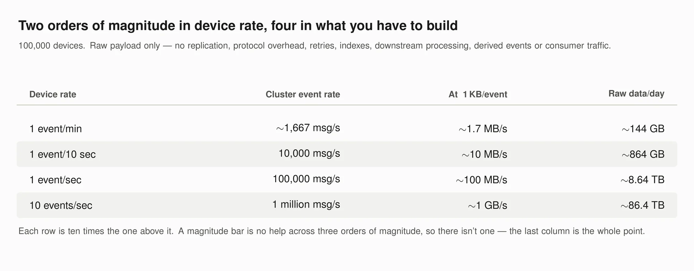
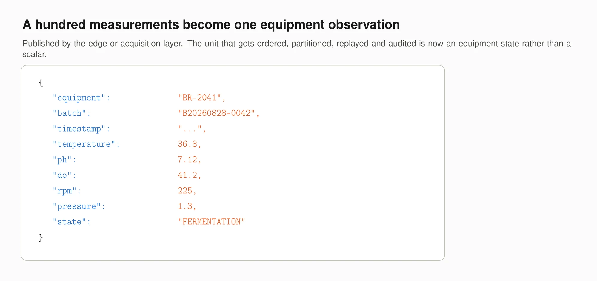
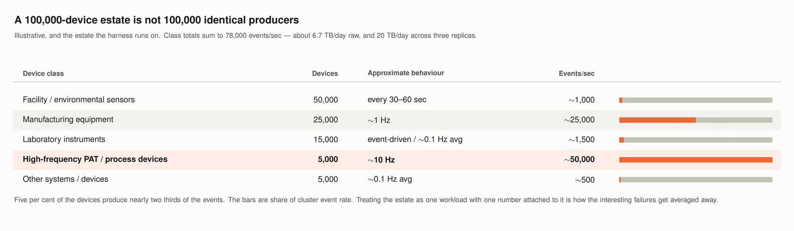
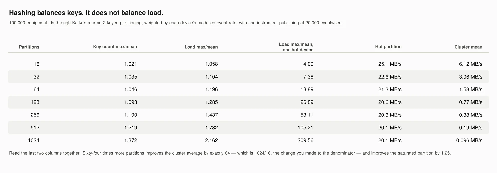
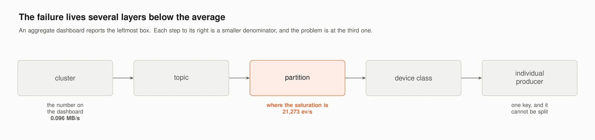

# At 100,000 Devices, Throughput Is the Easy Part

*By [Alexander Chernov](https://www.linkedin.com/in/thedoytsujin/). First published on LinkedIn, 2026-08-31. [Read the original](https://www.linkedin.com/pulse/100000-devices-throughput-easy-part-alexander-chernov-tz7bc/).*

---

*Part 1 of two: where the load actually lands.*

When someone says a hundred thousand pieces of equipment are connected to a streaming platform, the first question is almost always whether Kafka can handle it. It is a reasonable question, and it is close to the least interesting one available. At that scale the hard engineering is in bursts, backpressure, partition skew, replay, late data, recovery behaviour, failure domains, and reconstructing what actually happened — and a throughput benchmark answers none of it.

This gets more interesting in biopharma, where a "device" might be an environmental sensor, a bioreactor, a chromatography skid, a laboratory instrument, a PAT system, a sequencer, or an imaging platform. One device rarely means one signal.

I have not benchmarked a cluster of this size and this article does not claim to. What I did instead was measure the things that do not need a broker: the partitioner, the reporting schedule, and the arithmetic of recovery. Those are exactly computable over a real key space, and they run in the browser at [doytsujin.github.io/ok-kafka-estate-calc](https://doytsujin.github.io/ok-kafka-estate-calc/) if you want to put your own estate in — no cluster, nothing uploaded.

This part is about **where the load lands**: the arithmetic of the estate, what a key actually is, and the one measurement that decides how a partitioned log behaves under it. **Part 2** is about what happens when things move — recovery, reporting schedules, deployments and certificates. Everything here that is not measured — the estate, the device rates, the storage figures — is arithmetic from stated assumptions, and I have marked it as such.

## Start with the arithmetic

A useful first approximation is `events/sec = devices × events/device/sec`.

With 100,000 devices, a small change in reporting frequency changes the architecture dramatically.

Two orders of magnitude in device rate is four orders of magnitude of difference in what you have to build, and those are only raw payload numbers. They exclude replication, protocol overhead, retries, indexes, downstream processing, derived events, and consumer traffic.

## One device is not one measurement

A bioreactor or chromatography skid might expose temperature, pH, dissolved oxygen, agitation, pressure, flow, conductivity, UV, valve states, pump speeds, alarms, recipe state and batch state — potentially dozens or hundreds of tags. A naive architecture therefore turns 100,000 devices × 100 measurements × 1 sample/sec into ten million measurements per second. That does not mean ten million Kafka messages per second. The representation is a design decision, and it is made before anything reaches the broker.

Instead of publishing every tag independently, an edge or acquisition layer can produce one contextualised observation.

Where sampling semantics allow it, a hundred individual measurements become one semantically useful equipment observation. That is not an optimisation. It changes the shape of the entire distributed system, because the unit that gets ordered, partitioned, replayed and audited is now an equipment state rather than a scalar.

## A 100K-device estate is heterogeneous

I would not model a large biopharma environment as 100,000 identical producers. An illustrative estate looks more like the one below, and it is the one the harness runs on.

That averages around **78,000 events/sec**, or roughly **6.7 TB/day** of raw event data at 1 KB per event. With replication factor 3 the brokers are writing on the order of **20 TB/day across replicas**. Keep seven days online and the storage footprint is substantial before you add safety margin, segment overhead, tiered storage or consumer traffic.

Note where the volume lives. Five per cent of the devices produce nearly two thirds of the events. The estate is not one workload with one number attached to it, and treating it as one is how the interesting failures get averaged away.

A “100,000-device Kafka architecture” is therefore not a workload specification. Device count tells you the size of the estate. The distribution of event rates tells you what system you actually have to build.

This is unquestionably a serious streaming workload. Average throughput is still not the part I would worry about most.

## Partitioning solves ordering, and creates its own questions

For equipment telemetry a natural Kafka key is `equipment_id`, which keeps every observation from `BR-001` in the order it was produced. That does not mean one partition per piece of equipment: 100,000 devices is not 100,000 partitions, and a cluster configured that way would collapse under its own metadata.

Instead, `hash(equipment_id) → partition` distributes large numbers of equipment streams across a manageable partition set while preserving ordering per equipment identifier. The precise partition count depends on throughput, workload isolation, consumer parallelism, recovery requirements and operational constraints.

Hashing does not eliminate the next problem, which is skew — and this is the one I most wanted a number for.

## The hot-equipment problem, measured

I put all 100,000 equipment ids through Kafka's murmur2 keyed-partitioning calculation and weighted each key by its modelled event rate. The exact transcription, seed and modulo are in the calculator's source at [github.com/doytsujin/ok-kafka-estate-calc](https://github.com/doytsujin/ok-kafka-estate-calc). Then I gave one analytical instrument a firmware defect and let it publish at 20,000 events/sec instead of 10.

The first column is the hash doing its job. Key counts stay within five per cent of uniform, which is the result everyone expects and quietly stops checking after.

The rest of the table is the actual behaviour. Even with no hot device, load skew is already worse than key skew and grows with partition count, because devices do not all publish at the same rate and the hash cannot know that. Add one hot device and the ratio goes to 13.89× at 64 partitions and 209.56× at 1024.

Read the last two columns together, because that is the finding. Going from 16 partitions to 1024 improves the cluster average by exactly 64x — from 6.12 MB/s to 0.096 MB/s — and improves the actual bottleneck by a factor of 1.25, from 25.1 MB/s to 20.1 MB/s.

The 64 is not a measurement. It is 1024/16. The mean is total load over partition count, the total load did not change, so the average was always going to improve by exactly the factor you multiplied the denominator by. It is arithmetically incapable of reporting anything else, and it will do this on your cluster too, whatever is wrong with it. **Every partition you add makes the dashboard look better and the problem stay the same.** A single key is an unsplittable unit of load, and no partition count divides it.

I ran the whole thing again under an independent SHA-256 partitioner as a control. The numbers land within noise of murmur2 throughout, which is the point: this is a property of the workload, not of a hash function, and it will not be tuned away.

That is also why aggregate dashboards are insufficient rather than merely coarse. At this scale I want to be able to move down through the levels.

The failure lives several layers below the average, and the average gets more reassuring the further you drill away from it.

## Kafka probably should not carry the rawest scientific signal

Suppose an instrument produces a 10 kHz waveform, a large microscopy image, a chromatogram, sequencing output or a large spectrum. You can push these payloads through Kafka. For an enterprise biopharma architecture it is usually the wrong abstraction.

The object store holds the large payload. Kafka carries an event describing what happened, and that event is a few hundred bytes rather than a few hundred megabytes.

The event stream now carries meaning and state while object storage carries bulk scientific data. Kafka does not have to become a scientific file system in order to be central to the architecture.

## Three data planes

For a large biopharma environment I find it useful to separate three classes of information.

**Operational events** — `EquipmentStarted`, `BatchStarted`, `ValveOpened`, `AlarmRaised`, `SampleCollected`, `RunCompleted`, `QualityCheckFailed`. Compact, semantically rich, and a description of things that happened.

**Telemetry** — temperature, pressure, pH, flow, dissolved oxygen, RPM, environmental measurements. Higher-volume continuous information, and the plane most likely to be aggregated or downsampled before it reaches the enterprise streaming layer.

**Bulk scientific data** — spectra, images, chromatograms, sequencing data, microscopy, raw instrument files. These belong in object storage or another system optimised for large scientific objects, with Kafka carrying the event announcing that the object exists, where it is, what generated it, and how it relates to the surrounding process.

The three planes then work together instead of forcing every form of data through the same transport abstraction.

## Kafka becomes the nervous system, not the entire body

Put the three planes and the estate together and the architecture takes a definite shape.

At that point Kafka is not simply a message broker. It is closer to a nervous system carrying operational state across the estate — which means it stops being an application dependency and becomes production infrastructure, with everything that implies about how changes to it are made.

## What this part settles, and what it does not

One number is now firm, and it is not the one on the dashboard. Load skew is a property of the workload and not of the hash: a single key is an unsplittable unit of load, no partition count divides it, and every partition you add makes the average look better while the bottleneck stays exactly where it was. The cluster mean is arithmetically incapable of reporting anything else.

That is a statement about a system standing still. It says where the load sits when the estate is running normally, which is the easy case. It says nothing about what happens when twelve thousand devices reconnect at once, when every device in the fleet reports on the same second, when a deployment changes a schema, or when a certificate expires quietly on a Sunday.

Those are the cases where estates actually fail, and none of them shows up in an average either. That is Part 2.

---

<small>© 2026 Alexander Chernov. All rights reserved. First published on [LinkedIn](https://www.linkedin.com/pulse/100000-devices-throughput-easy-part-alexander-chernov-tz7bc/), which remains the canonical version; this page is a reprint by the author.</small>
